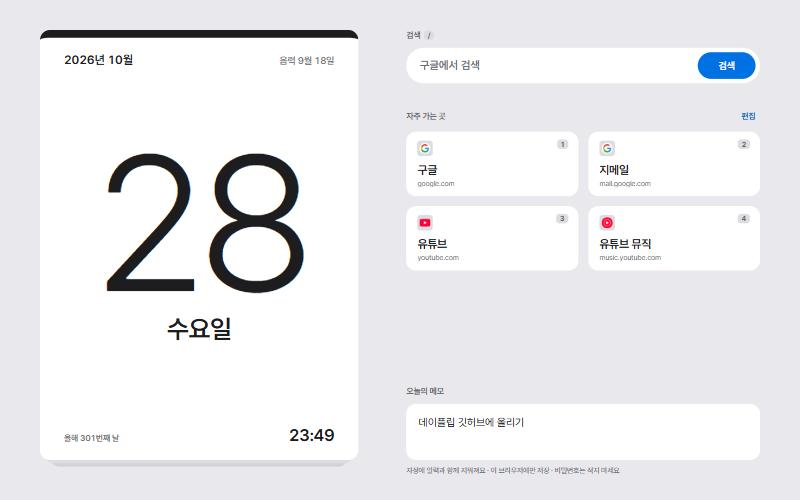

# DayFlip (데이플립)

A browser start page shaped like an **ilryeok** (일력), the Korean tear-off daily calendar: one sheet per day.

**The name reads two ways:**
- **flip calendar**: a pad you tear one sheet off each day
- **flip the day**: turn over to a new day

The first time you open the page each day, yesterday's sheet tears off and today's appears.

The live site is linked in the **About** panel on the right of this repository.

## Features

- **Today's sheet:** a large date and weekday, the Korean lunar date, the day of the year, and a clock.
- **Holidays:** Sundays and public holidays are red, Saturdays are blue, and holiday names are shown.
  - **Korea:** Seollal, Chuseok and Buddha's Birthday are calculated from the lunar calendar.
  - **United States:** the 11 federal holidays, calculated from their date rules, including observed days.
- **Weather:** the current temperature and conditions for a city you pick, next to the clock. Korea shows °C first; the United States shows °F first.
- **Anniversaries and D-days:**
  - An anniversary repeats every year, on the solar or the lunar calendar. Its name appears on the sheet in blue on the day.
  - A D-day happens once. The nearest one is counted down on the sheet (`D-25`) and removed the day after.
- **Settings on the back of the sheet:** click **설정** (Settings) under the sheet and it flips over.
  - **Language:** 한국어 or English. It follows your browser at first.
  - **Calendar region:** Korea or the United States, chosen separately from the language.
  - **Weather city**, and your **anniversaries and D-days**.
- **Google search:** results open in a new tab.
- **Favorite sites:**
  - Up to 9 sites.
  - Add, rename, reorder and delete them right on the page with **편집** (Edit). A deletion can be undone for 20 seconds.
  - Each site's icon appears automatically.
- **Today's memo:** jot down a line or two. It is cleared at midnight along with the day's sheet.
- **Light and dark mode:** follows your system setting.

## Keyboard shortcuts

| Key | Action |
|---|---|
| `1` – `9` | Open a favorite site, in order |
| `/` | Jump to the search box |
| `Esc` | Leave the search box or the memo, cancel a form, or close settings |

## Use it as your browser's start page

**Chrome:**
1. Go to **Settings → On startup → Open a specific page or set of pages**.
2. Add the DayFlip address.

**Edge:**
1. Go to **Settings → Start, home, and new tabs → When Edge starts → Open these pages**.
2. Add the DayFlip address.

## Make it your own

Everything lives in a single `index.html`, with comments (in Korean) explaining each part.

- **Default sites:** edit the `DEFAULT_LINKS` list. A short form like `naver.com` works.
  - Once you have edited the list on the page, that browser shows the page-edited list instead.
  - To go back to the file's list, click **편집 → 기본 목록으로** (Edit → Reset to defaults).
- **Colors:** change the values in `:root` at the top of the file.
- **Holidays:** substitute holidays and election days change every year; add them as lines in `KR_EXTRA`.
- **Switch search to Naver:** the Content Security Policy comment at the top of the file explains how.

## Privacy

- Your memo, edited site list, anniversaries, D-days and settings are stored **only in your browser** (localStorage). They are never uploaded to this repository.
- For the weather, only the **city name you search for** and the chosen city's **latitude and longitude** are sent to Open-Meteo. The page never asks for your location.
- To fetch site icons, only the **site's domain name** is sent to DuckDuckGo's icon service. Local network addresses (`192.168…`, `.local`, etc.) are never sent; they show the first letter of the name instead.
- Don't put passwords or other secrets in the memo.

## Known limitations

- Sites DuckDuckGo doesn't know get a generic grey icon.
- Gmail shows the same icon as Google.
- The Korean substitute-holiday list covers up to 2027.
- Some short Korean city names aren't found by the city search. Use the full name (`서울특별시`) or the English name (`Seoul`).

## Built with

- One HTML, CSS and JavaScript file. No build step.
- Font: [Pretendard](https://github.com/orioncactus/pretendard) (SIL Open Font License)
- Site icons: [DuckDuckGo](https://duckduckgo.com) icon service
- Lunar dates: the browser's built-in Korean lunar calendar (`ko-KR-u-ca-dangi`)
- Weather data by [Open-Meteo.com](https://open-meteo.com/) ([CC BY 4.0](https://creativecommons.org/licenses/by/4.0/))
- City search: Open-Meteo geocoding, based on [GeoNames](https://www.geonames.org/) ([CC BY 4.0](https://creativecommons.org/licenses/by/4.0/))
